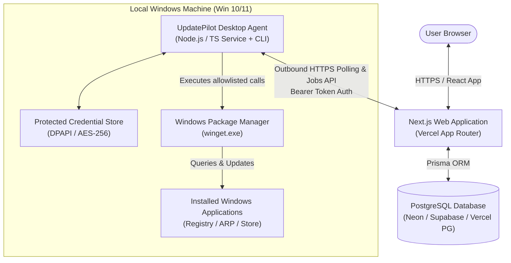
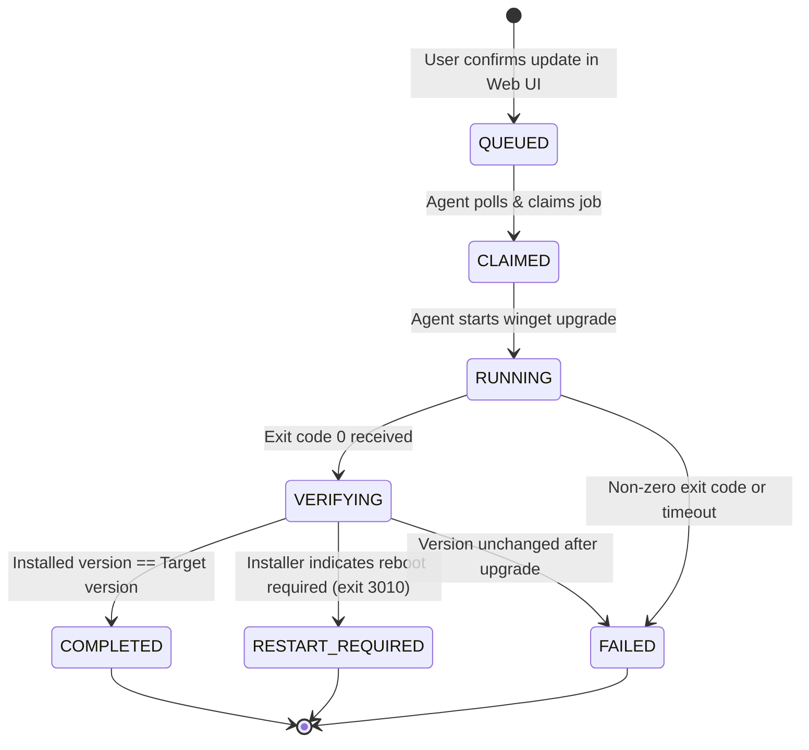

# UpdatePilot — System Architecture & Design Specification

## 1. High-Level Architecture Overview

UpdatePilot utilizes a distributed client-agent architecture optimized for Vercel serverless deployment and local Windows execution.



---

## 2. Component Breakdown

### 2.1 Web Frontend (`apps/web`)
- **Framework:** Next.js (App Router), React 19 / 18, TypeScript (Strict Mode).
- **Styling & Design System:** Tailwind CSS, Radix UI accessible primitives, Lucide React icons, Recharts for analytics data visualization.
- **State & Server Communication:** TanStack Query / React Hooks with typed API client, Server Actions and Route Handlers.
- **Theme Support:** Dark/Light theme toggle with CSS custom properties and persistent user preference.

### 2.2 Backend & API Layer (`apps/web/src/server`)
- **Route Handlers:** Next.js App Router `/api/v1/*` endpoints.
- **Layered Architecture:**
  - `controllers / route handlers`: HTTP parsing, input validation with Zod, status code mapping.
  - `services`: Core business logic (pairing, version comparison, job transition orchestration, security checks).
  - `repositories`: Database persistence abstractions wrapping Prisma Client.
- **Job Orchestration:** Asynchronous, database-backed job state machine (`ScanJob` and `UpdateJob`) to remain 100% compliant with Vercel's stateless serverless execution model.

### 2.3 Windows Desktop Agent (`agent/`)
- **Runtime:** Node.js (v18+) compiled executable / standalone runner with PowerShell launcher (`UpdatePilot-Agent.ps1`).
- **Core Modules:**
  - `DiscoveryEngine`: Queries installed applications via `winget list --accept-source-agreements` with structured fallback.
  - `WinGetAdapter`: Handles execution of strictly allowlisted WinGet commands (`list`, `show`, `upgrade`).
  - `PairingService`: Manages one-time code exchange, receives agent authentication token, and encrypts credentials on Windows host.
  - `JobWorker`: Outbound polling loop checking for approved `UpdateJob` and `ScanJob` tasks.
  - `VerificationEngine`: Post-upgrade version inspection and signature check ensuring real updates succeed before acknowledging completion.

### 2.4 Database (`prisma/schema.prisma`)
- **Provider:** PostgreSQL (hosted on Neon, Supabase, Vercel Postgres, or local instance).
- **ORM:** Prisma Client with relational constraints, cascade rules, and typed queries.

---

## 3. Communication Model & Job Lifecycle

### 3.1 Outbound Polling Pattern
Because end-user Windows machines typically reside behind NAT firewalls, routers, or corporate proxies, the Agent initiates all communication outbound via HTTPS to the Web API:
1. **Heartbeat & Status (`POST /api/v1/agent/heartbeat`):** Sent every 30 seconds to report device telemetry (OS version, agent version, online state).
2. **Job Polling (`GET /api/v1/agent/jobs/poll`):** Agent queries for pending jobs assigned to its `deviceId`.
3. **Job Claim (`POST /api/v1/agent/jobs/:id/claim`):** Atomic state update from `QUEUED` to `CLAIMED`.
4. **Progress & Verification Submission (`POST /api/v1/agent/jobs/:id/report`):** Streams stdout summaries, exit code, and post-update verified version.

### 3.2 Update Job State Machine



---

## 4. Vercel Serverless Architecture Guarantees
- **No Long-Running Server Processes:** Updates take between 30 seconds and 5 minutes depending on network and installer size. Serverless API routes on Vercel would timeout if they attempted to hold an open connection during installation. UpdatePilot decouples job creation from execution via persistent PostgreSQL job queues.
- **Stateless API Handlers:** Every API request is authenticated independently via JWT / session cookie (for users) or Bearer token HMAC hash (for agents).
- **Environment Isolation:** Zero reliance on local disk or in-memory caches between serverless invocations.

---

## 5. Directory & Package Architecture

```text
UpdatePilot/
├── apps/
│   └── web/                   # Next.js App Router Web Application & Backend API
│       ├── public/            # Static assets and icons
│       └── src/
│           ├── app/           # App router pages & route handlers (/api/v1/*)
│           ├── components/    # Reusable UI primitives & layout
│           ├── features/      # Feature-sliced modules (dashboard, apps, updates, settings)
│           ├── hooks/         # Custom React hooks
│           ├── lib/           # Utility helpers (version comparator, logger, formatting)
│           ├── server/        # Backend services, repositories, auth, security
│           └── types/         # Domain TypeScript types
├── agent/                     # Windows Desktop Agent
│   ├── src/
│   │   ├── adapters/          # WinGet process wrapper & output parser
│   │   ├── core/              # Polling worker, discovery engine, verifier
│   │   ├── security/          # DPAPI credential vault & token handling
│   │   └── index.ts           # Agent CLI entry point
│   ├── UpdatePilot-Agent.ps1  # Windows PowerShell quick-launch wrapper
│   └── tests/                 # Agent unit and integration tests
├── packages/
│   └── shared/                # Cross-tier TypeScript contracts, schemas, and types
│       ├── schemas/           # Zod schemas for all API payloads and jobs
│       ├── types/             # Domain entities and status enums
│       └── index.ts
├── prisma/
│   ├── schema.prisma          # PostgreSQL relational schema
│   └── seed.ts                # Idempotent development seed data
├── docs/                      # Comprehensive engineering documentation
├── tests/                     # Integration and E2E test suites
├── .env.example               # Documented environment variables template
├── .gitignore
├── README.md
└── package.json               # Monorepo / workspace orchestration
```
