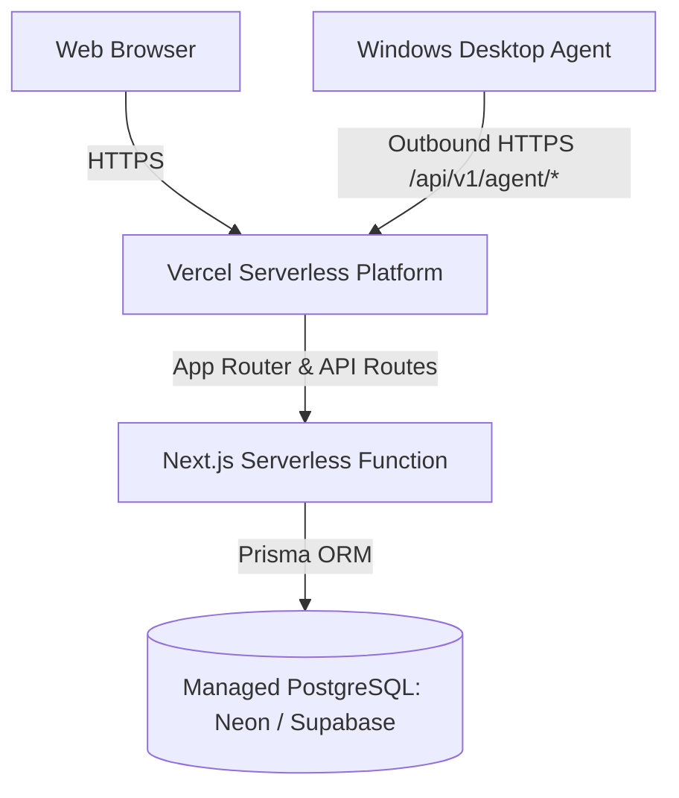

# UpdatePilot — Vercel & Production Deployment Guide

## 1. Architecture Overview
UpdatePilot is configured for serverless hosting on **Vercel** using the repository-root [`vercel.json`](../vercel.json) combined with a managed PostgreSQL database (**Neon**, **Supabase**, or **Vercel Postgres**), alongside locally installed Windows Desktop Agents.



---

## 2. Prerequisites
1. **GitHub Repository:** Push this repository to GitHub.
2. **Managed PostgreSQL Database:**
   - [Neon Serverless Postgres](https://neon.tech)
   - [Supabase Database](https://supabase.com)
   - Or Vercel Postgres integration
3. **Vercel Account:** Connected to your GitHub repository or using `vercel` CLI.

---

## 3. Step-by-Step Vercel Deployment

### Step 1: Connect Git Repository to Vercel
1. Log into your Vercel Dashboard and click **Add New Project**.
2. Import the `UpdatePilot` Git repository.
3. Keep **Root Directory** at the repository root (`.`) — [`vercel.json`](../vercel.json) automatically sets:
   - **Install Command:** `npm install`
   - **Build Command:** `npm run build` (runs `prisma generate`, builds `@updatepilot/shared`, and builds `apps/web`)
   - **Output Directory:** `apps/web/.next`

### Step 2: Configure Production Environment Variables
In Vercel Project Settings under **Environment Variables**, set:

| Variable | Required | Description |
| :--- | :---: | :--- |
| `DATABASE_URL` | **Yes** | Pooled PostgreSQL connection string with SSL (`?sslmode=require`) |
| `SESSION_SECRET` | **Yes** | Cryptographic 32+ byte secret (`openssl rand -base64 32`) |
| `NEXT_PUBLIC_APP_URL` | **Yes** | Your deployed URL (e.g. `https://updatepilot.vercel.app`) |
| `PAIRING_CODE_TTL_MINUTES` | Optional | Pairing code lifetime in minutes (default `10`) |
| `DEFAULT_ADMIN_PASSWORD` | Optional | Initial password when running `npm run prisma:seed` |
| `INSTALLER_DOWNLOAD_URL` | Optional | Public URL (e.g. GitHub Release asset) for `UpdatePilot-Agent-Setup-1.0.0-x64.exe` |

### Step 3: Push Schema & Seed Initial Admin (or Register via UI)
Run Prisma schema push/migrations against your production PostgreSQL URL:
```bash
npx prisma db push
# Or if using migration history:
npx prisma migrate deploy

# Optional: seed initial admin account (admin@updatepilot.local)
npm run prisma:seed
```
Alternatively, visit `/login` on your deployed app and use **Create Account** to register the initial administrator account (the first registered user on an empty database is automatically granted `ADMIN` role).

### Step 4: Deploy & Pair Windows Agents
1. Trigger deployment in Vercel (`vercel --prod` or push to `main`).
2. Verify health check:
   - `GET https://your-domain.vercel.app/api/v1/health` returns `{ "success": true, "data": { "status": "ok", "storageMode": "postgresql" } }`.
3. Open `https://your-domain.vercel.app`, sign in, and click **Connect Host** -> **Connect Any Computer (Fleet)** to generate a pairing code and connect any Windows 10/11 machine via the `.exe` installer or PowerShell client (`/api/v1/agent/install`).
