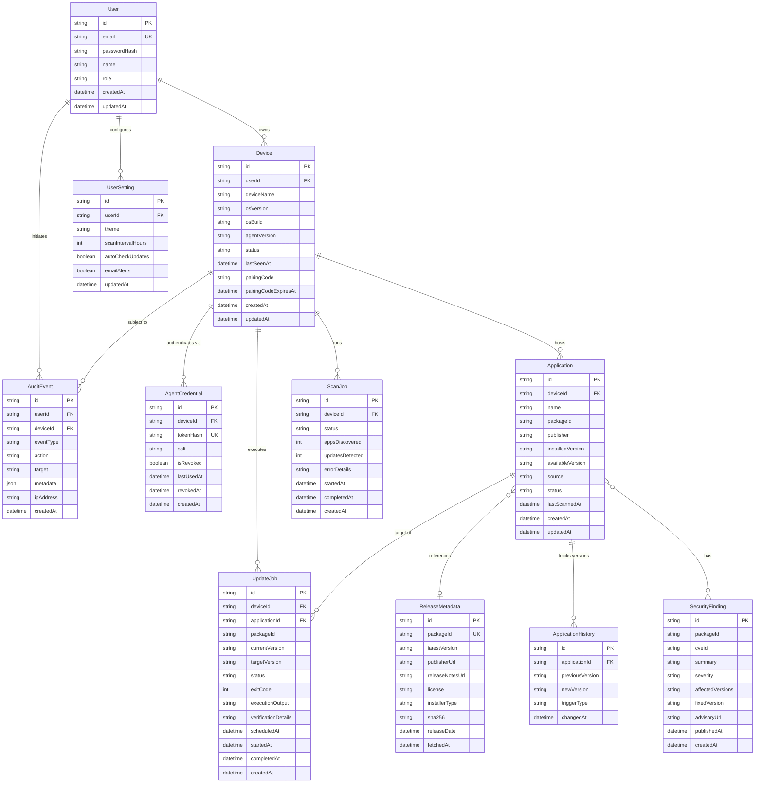

# UpdatePilot — Database Entity-Relationship Specification

## 1. Relational ER Diagram

---

## 2. Table Specifications & Indexes

### 2.1 `User`
- **Purpose:** Stores authenticated dashboard users.
- **Indexes:**
  - `email` (UNIQUE)

### 2.2 `Device`
- **Purpose:** Represents individual registered Windows hosts.
- **Indexes:**
  - `userId` (FK index)
  - `pairingCode` (INDEX, nullable, for fast one-time claim lookups)
  - `status` (INDEX)

### 2.3 `AgentCredential`
- **Purpose:** Stores salted and hashed agent bearer authentication tokens.
- **Security Rule:** Plaintext tokens are NEVER stored in the database.
- **Indexes:**
  - `deviceId` (FK index)
  - `tokenHash` (UNIQUE index)

### 2.4 `Application`
- **Purpose:** Software applications discovered on a specific device during scans.
- **Statuses:** `UP_TO_DATE`, `UPDATE_AVAILABLE`, `UNKNOWN_VERSION`, `UNSUPPORTED`, `UNMATCHED`.
- **Indexes:**
  - `[deviceId, packageId]` (UNIQUE composite where packageId is known)
  - `[deviceId, status]` (INDEX for fast filtering in inventory and update center)

### 2.5 `ReleaseMetadata`
- **Purpose:** Cached package metadata fetched from WinGet or official publisher sources.
- **Indexes:**
  - `packageId` (UNIQUE index)

### 2.6 `ScanJob`
- **Purpose:** Tracks software discovery scan jobs dispatched to an agent.
- **Statuses:** `QUEUED`, `CLAIMED`, `RUNNING`, `COMPLETED`, `FAILED`, `CANCELLED`.
- **Indexes:**
  - `deviceId` (FK index)
  - `status` (INDEX)
  - `createdAt` (INDEX)

### 2.7 `UpdateJob`
- **Purpose:** Represents a user-confirmed software update lifecycle.
- **Statuses:** `QUEUED`, `CLAIMED`, `RUNNING`, `VERIFYING`, `COMPLETED`, `FAILED`, `RESTART_REQUIRED`, `CANCELLED`.
- **Indexes:**
  - `deviceId` (FK index)
  - `applicationId` (FK index)
  - `status` (INDEX)
  - `createdAt` (INDEX)

### 2.8 `AuditEvent`
- **Purpose:** Immutable audit trail of administrative and agent actions.
- **Indexes:**
  - `userId` (FK index)
  - `deviceId` (FK index)
  - `eventType` (INDEX)
  - `createdAt` (INDEX)

---

## 3. Data Retention and Cleanup Rules
1. **Audit Logs:** Retained for 90 days minimum; immutable (no updates or deletes permitted via public API).
2. **Scan Snapshots:** Historical scan records older than 60 days are periodically aggregated.
3. **Completed Jobs:** Kept for 30 days to power update history and diagnostics before archiving.
