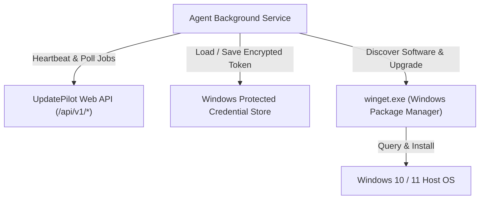

# UpdatePilot — Windows Desktop Agent Engineering Manual

## 1. Overview & Architectural Role

The **UpdatePilot Windows Desktop Agent** (`@updatepilot/agent`) is a lightweight, secure Windows client that executes local system inspection and package management operations. Because web browsers operating within the sandbox cannot inspect native Windows installed software or run system updates, the Agent serves as the local bridge between the operating system and the UpdatePilot cloud dashboard.



---

## 2. Core Responsibilities

1. **Host Environment Detection:** Identifies Windows OS build, architecture, and verifies availability of `winget.exe`.
2. **Software Discovery:** Executes `winget list --accept-source-agreements` to discover installed applications, versions, and trusted sources.
3. **Outbound HTTPS Handshake:** Establishes secure communication without opening inbound network ports or requiring firewall alterations.
4. **Credential Protection:** Stores persistent authentication tokens using Windows Data Protection API (DPAPI) and hardware-salted AES-256-GCM.
5. **Safe Upgrade Execution:** Strictly executes allowlisted package upgrade commands:
   `winget.exe upgrade --id <PackageId> --exact --accept-package-agreements --accept-source-agreements`
6. **Rigorous Post-Install Verification:** Re-queries the local package inventory to verify that the target version actually took effect before reporting success.

---

## 3. Installation & Getting Started

### 3.1 Prerequisites
- Supported Operating System: Windows 10 (version 1809+) or Windows 11
- Windows Package Manager (`winget.exe`, included in Windows 11 and Windows 10 App Installer)
- Node.js runtime (v18.0.0 or newer)

### 3.2 Quick Launch via PowerShell Launcher
The agent repository includes an automated PowerShell launcher script:
```powershell
# Check agent status and host connectivity
.\agent\UpdatePilot-Agent.ps1 status

# Pair with your UpdatePilot dashboard using the 6-digit code
.\agent\UpdatePilot-Agent.ps1 pair -Code UP-849201 -Server http://localhost:3000

# Perform an immediate software inventory scan
.\agent\UpdatePilot-Agent.ps1 scan

# Start continuous background service worker
.\agent\UpdatePilot-Agent.ps1 service
```

### 3.3 Direct CLI Commands
```bash
# Build the TypeScript agent
npm --workspace=agent run build

# Pair host
node agent/dist/index.js pair --code UP-XXXXXX --server http://localhost:3000

# Check status
node agent/dist/index.js status

# Start service
node agent/dist/index.js service

# Clear credentials and unpair
node agent/dist/index.js unpair
```

---

## 4. Security & Safety Model

- **No Remote Shells:** The agent does NOT expose a command shell or accept shell commands from the cloud.
- **Strict Package ID Validation:** Package IDs are strictly validated against `/^[A-Za-z0-9_\-\.\+]+$/` to prevent parameter injection.
- **No Signature Overrides:** The `--ignore-security-hash` flag is permanently forbidden.
- **UAC Privilege Boundaries:** The agent runs under normal user permissions and only prompts for elevation if an MSI/EXE installer requires administrator privileges.
